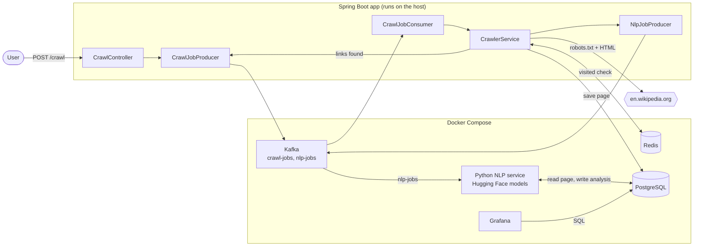
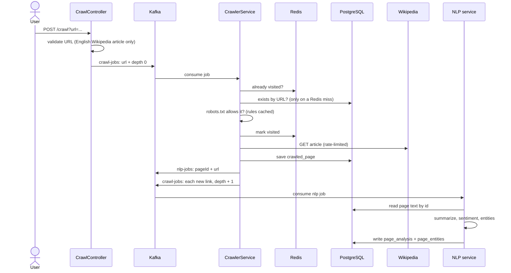

# Architecture

WikiCrawl is a targeted web crawler with an NLP pipeline attached. A Spring Boot service crawls English Wikipedia one page at a time, using Kafka as the work queue, Redis and PostgreSQL to avoid revisiting pages, and robots.txt plus rate limiting to follow Wikipedia's web crawler rules and to avoid causing unnecessary traffic. Every crawled page is stored in PostgreSQL, then analyzed asynchronously by a Python service running three Hugging Face models (summarization, sentiment, named entities). Grafana reads the results straight from the PostgreSQL database.

This document explains how the pieces fit together and why they were built this way. For the quick start see the [README](../README.md); for the schema and ways to query or export the data see [data.md](data.md).

## 1. System overview

The crawler runs on the host with Maven while everything else runs in Docker Compose. The crawler and the NLP service never talk to each other directly and only share Kafka and PostgreSQL.

## 2. Components

| Component | Role | Notes |
|---|---|---|
| **Spring Boot app** | Exposes `POST /crawl`, consumes crawl jobs, fetches and parses pages, enforces robots.txt and rate limits, publishes new jobs | Jsoup for HTML, OkHttp and crawler-commons for robots.txt |
| **Kafka** (`apache/kafka:3.7.0`, KRaft) | Work queue between crawl steps, and between the crawler and the NLP service | Single node, no Zookeeper. Two listeners: `kafka:9092` inside Docker, `localhost:9094` for the host-run app |
| **Redis** (`redis:7.2-alpine`) | Fast duplicate page check | One key per URL (`visited:url:<url>`), persisted to a volume |
| **PostgreSQL** (`postgres:17`) | System of record for crawled pages, summaries, sentiment, and entities | The data source for Grafana and its dashboard and panels|
| **Python NLP service** | Consumes `nlp-jobs`, reads the page text from PostgreSQL, runs the models, writes results back | `confluent-kafka`, SQLAlchemy, Hugging Face `transformers` |
| **Grafana** | Dashboard over the stored data | Datasource and dashboard are provisioned from files, so no manual setup is required|

### Kafka topics

| Topic | Message | Producer → Consumer |
|---|---|---|
| `crawl-jobs` | `{ url, depth }` | Spring app → Spring app (a crawl feeds itself) |
| `nlp-jobs` | `{ pageId, url }` | Spring app → Python NLP service |
| `crawl-jobs.DLT` | failed crawl jobs | Spring error handler → (inspect manually) |

### NLP models

| Task | Model | Input given to the model |
|---|---|---|
| Summarization | `facebook/bart-large-cnn` | first 4,000 characters, cut to 1,024 tokens; 30 to 130 token summary |
| Sentiment | `cardiffnlp/twitter-roberta-base-sentiment` | first 2,000 characters, truncated at 512 tokens; labels mapped to NEGATIVE / NEUTRAL / POSITIVE |
| Entities | `dslim/bert-base-NER` | first 2,000 characters, at most 510 tokens; duplicate entity words are dropped per page |

## 3. Life of a crawl

1. **Seed.** `POST /crawl?url=...` validates that the URL is an English Wikipedia article (HTTPS, exact host, `/wiki/` path, no namespace such as `Special:`). Anything else is rejected, because the crawler only fetches robots.txt for Wikipedia. A seed that was already crawled gets a `409` instead of being silent. The valid seed is published as a `CrawlJob` with a depth value of 0.
2. **Consume.** `CrawlJobConsumer` receives one job (one page) at a time.
3. **Skip checks.** The job is dropped if the URL isn't HTTP(S), reaches `max-depth`, was already visited (Redis, then PostgreSQL if Redis fails), or is not allowed by robots.txt.
4. **Fetch.** The URL is marked visited in Redis, the rate limiter actives if needed, and Jsoup downloads the page.
5. **Extract and store.** The title (`h1#firstHeading`) and body text (all paragraphs under `div.mw-parser-output`) are saved to `crawled_page`.
6. **Hand off to NLP.** An `NlpJob` containing only the page id and URL goes to `nlp-jobs`.
7. **Follow links.** Links in the article body are filtered (Wikipedia article URLs only; no namespaces, anchors, or Main Page) and every link not already in Redis is published to `crawl-jobs` with `depth + 1`. The producer refuses anything beyond `max-depth`.
8. **Analyze.** The NLP service loads the page by id, runs the three models, and writes one `page_analysis` row plus its `page_entities` rows.

`max-depth` counts link hops from the seed: with `max-depth: 1` the crawl covers the seed page and every page it links to directly.

## 4. Design decisions

### One page per Kafka message
**Why:** The queue *is* the crawl frontier. Each message is small and independent, so the crawler is capable of stopping after any record. This means that it can resume where it left off or retry or dead-letter a bad page without losing the rest. With one partition the topic behaves as a FIFO queue, which makes the crawl breadth-first.
**Trade-off:** More moving parts than a recursive in-process crawl, and the consumer has to keep per-page work short.

### Depth travels inside the message
**Why:** `CrawlJob(url, depth)` makes every job self-describing. The depth limit is enforced both when publishing and when consuming, which prevents any runaway crawls and loops that lack any shared counter.

### Two-level duplicate detection
**Why:** Redis checks whether a url has been seen in microseconds, which matters when a single article can link to hundreds of pages. PostgreSQL stays the source of truth, so if Redis is empty for whatever reason, the crawler consults the database and re-warms the cache instead of needing to re-crawl.
**Trade-off:** A URL is marked visited *before* it is fetched, so any failed fetch could leave a URL that is never saved and never retried (see [Limitations](#6-limitations)).

### Kafka carries pointers, not payloads
**Why:** The `nlp-jobs` message holds only `pageId` and `url` while the NLP service reads the full text from PostgreSQL. This results in messages staying tiny, and nothing large ever gets passed through Kafka.

### A separate Python service for NLP
**Why:** The Hugging Face ecosystem is Python-first, and model inference is much slower than crawling. Because the two sides only meet at a Kafka topic, a slow model doesn't throttles the crawler, meaning that the queue absorbs the difference, and either side can be restarted independently.
**Trade-off:** Two languages, two runtimes, and a schema needs to be shared across both.

### Politeness is built in
**Why:** The crawler fetches and honors Wikipedia's robots.txt (parsed with crawler-commons, cached after the first successful fetch), identifies itself with a descriptive user agent, and waits `request-delay-ms` between requests (500 ms by default), so a crawl shouldn't hammer the site it targets. The delay is configurable but should stay conservative considering the repercussion of not following them.

### Explicit Kafka configuration
**Why:** `KafkaConfig` builds the consumer and listener-container factories by hand, because they need a custom error handler (retry twice, one second apart, then publish to `crawl-jobs.DLT`). The trade-off is that Spring Boot's `spring.kafka.consumer.*` and `spring.kafka.listener.*` properties are **not** applied automatically; `KafkaConfig` reads the ones it needs (offset reset, batch size, stop behavior). This was learned the hard way: shutdown was slow until the stop settings were applied in code rather than in `application.yml` alone.

### Dashboard as code
**Why:** The Grafana datasource and dashboard live in the repository and are mounted into the container, so a fresh clone gets a working dashboard without any clicking for the user. The dashboard queries PostgreSQL directly (sentiment distribution, top 20 entities, pages crawled per day), so it shows what was collected rather than some operational metrics.

## 5. Reliability

**Startup ordering.** The infrastructure has health checks (Postgres, Redis, Kafka), and `docker compose up -d --wait` returns only when they pass. The NLP container also waits for healthy Kafka and Postgres. Since the crawler runs on the host, ordering is covered by the README steps, which involves starting the containers, then the main app.

**Failures while crawling.** An exception in the crawl listener is retried twice, then the record goes to `crawl-jobs.DLT` upon complete failure. Network errors on a fetch are caught and logged, and the page is skipped.

**Failures while analyzing.** Each model call is wrapped separately, meaning that one failing model produces a fallback value (`UNKNOWN`, or an "analysis failed" summary) rather than losing the page. Database errors are also logged, but its important to note that there is no retry or dead-letter topic on the Python side.

**Graceful shutdown.** The listener container is configured to stop after the record being processed (`stopImmediate`) and to commit the offsets per record with small poll batches. Pressing Ctrl+C stops the crawler within about one page's worth of work. Records that were polled but not processed are redelivered on the next start up, and the Redis and database duplicate checks makes those retries harmless.

**Persistence.** PostgreSQL and Redis data live in named Docker volumes (Redis snapshots with `--save 20 1`). `docker compose down` keeps them; `docker compose down -v` wipes everything in the need of a fresh start.

## 6. Limitations

- **Wikipedia only.** The base URL, link filters and CSS selectors are written for Wikipedia. The seed validation exists specifically because other sites would bypass the robots.txt handling.
- **One consumer, one rate limiter.** The rate limit lives in memory inside a single consumer thread. Scaling out would need more topic partitions and a shared  limiter, otherwise the combined request rate would exceed the configured delay.
- **Visited-before-fetch.** A URL with a failed fetch stays marked as visited and is skipped on later runs until Redis and the page table are reset.
- **Partial text analysis.** Models only see the first 2,000 to 4,000 characters of an article, so summaries and entities reflect the beginning of long pages rather than the entire contents.
- **Sentiment on encyclopedic text.** The sentiment model was trained on (X/Formerly Twitter) tweets, so results on Wikipedia articles tend to skew neutral and should be read as a rough signal, and not grounded truth.
- **NLP delivery guarantees.** The Python consumer commits offsets **after** processing, but a failed page isn't retried, and a redelivered message would write a second analysis row (there is no unique constraint on `page_id`).
- **Schema management.** Hibernate (`ddl-auto: update`) and SQLAlchemy (`create_all`) both create tables, with no migration tool, so the two sides must stay manually in sync.
- **Local-first security.** `POST /crawl` lacks authentication and is meant for only localhost. The Compose stack is intended for local use.
- **Grafana version.** The dashboard export uses Grafana's newer dashboard schema and the image is not pinned to a version, so differing Grafana versions may not load it.
- **Resource use.** The three models run on CPU, are large downloads on first start (cached in a volume), and analyze far slower than the crawler fetches. So expect `nlp-jobs` to build up a backlog during a given crawl session.